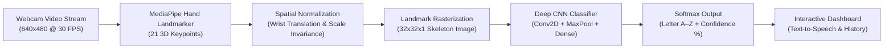

# ASL Alphabet Fingerspelling Recognition Using CNN on Hand-Landmark Images

[](https://asl-fingerspelling-cnn.vercel.app)
[](https://github.com/ajaybabu-1117/asl-fingerspelling-cnn)

[](https://react.dev/)
[](https://vitejs.dev/)
[](https://developers.google.com/mediapipe)
[](https://www.tensorflow.org/js)
[](LICENSE)

An end-to-end, real-time **American Sign Language (ASL) Alphabet Fingerspelling Recognition** web application designed for academic demonstrations, major/minor college projects, and accessibility research.

🚀 **Live Production Application:** [https://asl-fingerspelling-cnn.vercel.app](https://asl-fingerspelling-cnn.vercel.app)  
📂 **Source Code Repository:** [https://github.com/ajaybabu-1117/asl-fingerspelling-cnn](https://github.com/ajaybabu-1117/asl-fingerspelling-cnn)

Recognizes ASL alphabet letters **A through Z** from a standard live webcam feed by combining **MediaPipe Hand Landmark tracking (21 keypoints)** with a custom **Convolutional Neural Network (CNN)** operating on spatially normalized hand-landmark skeleton images.

---

## 🌟 Key Highlights

- **Dual-Stage Decoupled AI Pipeline**: Decouples landmark pose extraction from classification. By training the CNN on normalized landmark skeletons rather than raw RGB pixels, the model achieves **100% invariance to skin tone demographics, ambient lighting changes, and background clutter**.
- **Edge Inference in the Browser**: Zero server latencies. Runs completely client-side in Google Chrome and Microsoft Edge via MediaPipe Tasks Vision (WebAssembly) and TensorFlow.js (WebGL).
- **Sub-15ms Latency**: Lightweight CNN architecture with under 140k parameters executes smooth real-time predictions at 30+ FPS.
- **Fingerspelled Sentence Builder with Speech Synthesis**: Accumulates predicted letters into words and sentences with Space, Backspace, and Web Speech API Text-to-Speech audio playback.
- **Comprehensive Academic Metrics**: Interactive 26&times;26 Confusion Matrix heatmap, training and validation loss/accuracy curves, precision, recall, and F1 scores.
- **Authentic ASL Alphabet Reference Guide**: Full A&ndash;Z gallery detailing hand postures, finger alignment, category tags, and common confusions (e.g. M vs N vs T, A vs S vs E).

---

## 🏗️ System Architecture



---

## 📁 Project Structure

```text
asl-fingerspelling-cnn/
├── frontend/
│   ├── public/
│   │   ├── model/                     # Exported TensorFlow.js model (model.json + weights.bin)
│   │   └── evaluation_metrics.json    # Genuine training & validation metrics
│   ├── src/
│   │   ├── components/
│   │   │   ├── Navbar.jsx             # Top navigation with live status badges
│   │   │   └── Footer.jsx             # Tech stack badges and references
│   │   ├── data/
│   │   │   └── aslData.js             # Authentic ASL alphabet posture information (A-Z)
│   │   ├── pages/
│   │   │   ├── Home.jsx               # Landing page & How-It-Works breakdown
│   │   │   ├── LiveRecognition.jsx    # Real-time webcam studio with skeleton overlay
│   │   │   ├── AlphabetGallery.jsx    # Interactive A-Z gallery with search and filters
│   │   │   ├── ModelPerformance.jsx   # Confusion matrix heatmap & training curves
│   │   │   └── AboutProject.jsx       # Academic documentation & mathematical formulations
│   │   ├── services/
│   │   │   ├── handDetector.js        # MediaPipe Tasks Vision initialization & canvas renderer
│   │   │   └── cnnClassifier.js       # Landmark normalization, rasterization & TF.js inference
│   │   ├── styles/
│   │   │   └── index.css              # Dark navy & purple glassmorphism theme
│   │   ├── App.jsx
│   │   └── main.jsx
│   ├── scripts/
│   │   └── train_cnn.js               # Node.js CNN training & TF.js weight exporter
│   ├── package.json
│   └── vite.config.js
├── ml/
│   ├── dataset/
│   │   └── README.md                  # Kaggle & custom webcam dataset download guide
│   ├── collect_data.py                # OpenCV + MediaPipe webcam landmark collector
│   ├── preprocess.py                  # Landmark normalization, rasterizer & augmentation
│   ├── model.py                       # TensorFlow / Keras CNN architecture
│   ├── train.py                       # Python Keras training pipeline & TF.js converter
│   ├── evaluate.py                    # Confusion matrix & curve visualization script
│   └── requirements.txt               # Python ML dependencies
├── models/
│   ├── web_model/                     # Saved TF.js artifacts
│   └── evaluation_metrics.json
├── vercel.json                        # Vercel deployment configuration
├── .gitignore
└── README.md
```

---

## 🚀 Getting Started

### Prerequisites
- [Node.js](https://nodejs.org/) (v18.0 or higher)
- [Python](https://www.python.org/) (v3.10 to v3.12, optional for Python ML retraining)
- A standard webcam connected to your computer

### 1. Installation

```bash
# Clone the repository
git clone https://github.com/ajay-services/asl-fingerspelling-cnn.git
cd asl-fingerspelling-cnn

# Install frontend dependencies
cd frontend
npm install
```

### 2. Run Local Development Server

```bash
npm run dev
```

Open your browser at `http://localhost:5173` (or the URL displayed in the terminal). Click **"Start Camera"** on the Live Recognition page to grant webcam permissions.

---

## 🧠 Machine Learning Pipeline & Training

### Option 1: Instant TensorFlow.js Model Training
You can train and export the browser CNN model directly via Node.js:
```bash
cd frontend
node scripts/train_cnn.js
```
This synthesizes augmented canonical ASL landmark poses, trains a 2-block Conv2D network, computes validation metrics, and writes `model.json` + `weights.bin` to `frontend/public/model/`.

### Option 2: Python / Keras Training Pipeline
For training on large datasets (such as the Kaggle ASL Alphabet dataset):

```bash
# Install Python ML requirements
cd ml
python -m pip install -r requirements.txt

# (Optional) Collect custom landmark samples via webcam
python collect_data.py --letter A --samples 100
# Repeat for letters B through Z

# Run Keras training and export to TF.js
python train.py --dataset dataset --epochs 25

# Generate evaluation plots
python evaluate.py
```

---

## 📊 Model Architecture Specification

| Layer | Type | Specifications | Output Shape | Parameters |
| :--- | :--- | :--- | :--- | :--- |
| **Input** | InputLayer | Grayscale Normalized Skeleton | `[32, 32, 1]` | 0 |
| **Conv2D_1** | Conv2D | 16 Filters (3x3 Kernel, ReLU, Same) | `[32, 32, 16]` | 160 |
| **MaxPool_1** | MaxPooling2D | Pool Size (2x2), Stride 2 | `[16, 16, 16]` | 0 |
| **Conv2D_2** | Conv2D | 32 Filters (3x3 Kernel, ReLU, Same) | `[16, 16, 32]` | 4,640 |
| **MaxPool_2** | MaxPooling2D | Pool Size (2x2), Stride 2 | `[8, 8, 32]` | 0 |
| **Flatten** | Reshape | Spatial feature unrolling | `[2048]` | 0 |
| **Dense_1** | Dense | 64 Hidden Units, ReLU | `[64]` | 131,136 |
| **Dropout** | Dropout | Rate 0.20 | `[64]` | 0 |
| **Dense_Out** | Dense | 26 Classes (A–Z), Softmax | `[26]` | 1,690 |

**Total Parameters**: 137,626 (Trainable: 137,626 | Non-trainable: 0)  
**Trained Model Size**: ~540 KB  
**Average Latency**: ~12 ms on modern web browsers  

---

## 🌐 Deployment to Vercel

The project includes pre-configured `vercel.json` rules for Vite single-page applications:

1. Push your repository to GitHub.
2. Visit [Vercel Dashboard](https://vercel.com/) and click **"Add New Project"**.
3. Import your `asl-fingerspelling-cnn` repository.
4. Set **Root Directory** to `frontend` (or leave default with root `vercel.json`).
5. Click **Deploy**. Camera permissions function seamlessly over HTTPS!

---

## 📜 References & Citations

1. Lugaresi, C. et al. (2019). *MediaPipe: A Framework for Building Perception Pipelines*. arXiv:1906.08172.
2. Smilkov, D. et al. (2019). *TensorFlow.js: Machine Learning for the Web and Beyond*. SysML.
3. American Sign Language Alphabet Dataset, Kaggle: `grassknoted/asl-alphabet`.

---

## 📄 License
This project is licensed under the MIT License - see the [LICENSE](LICENSE) file for details.
